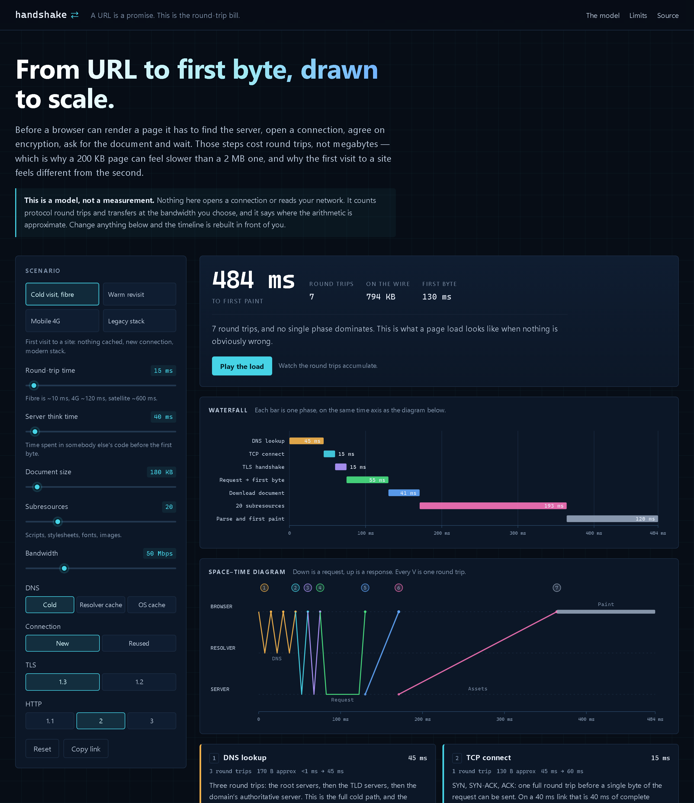
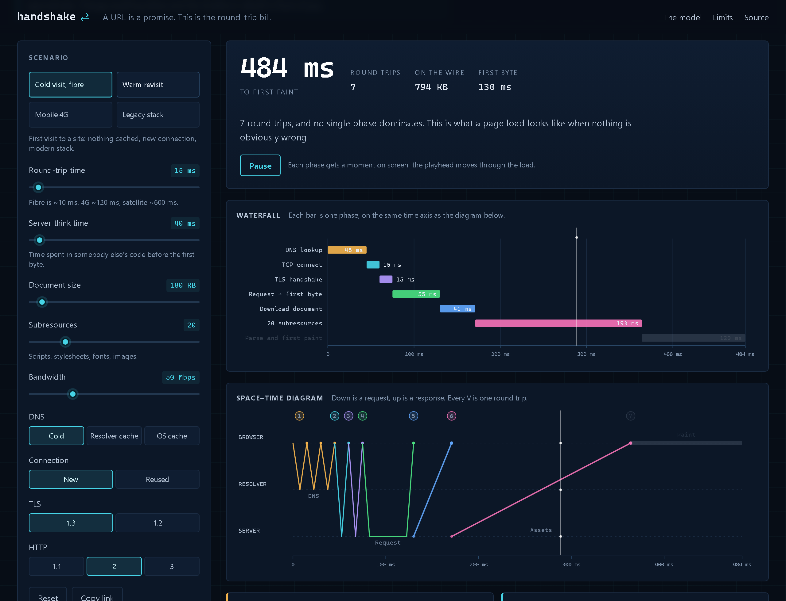
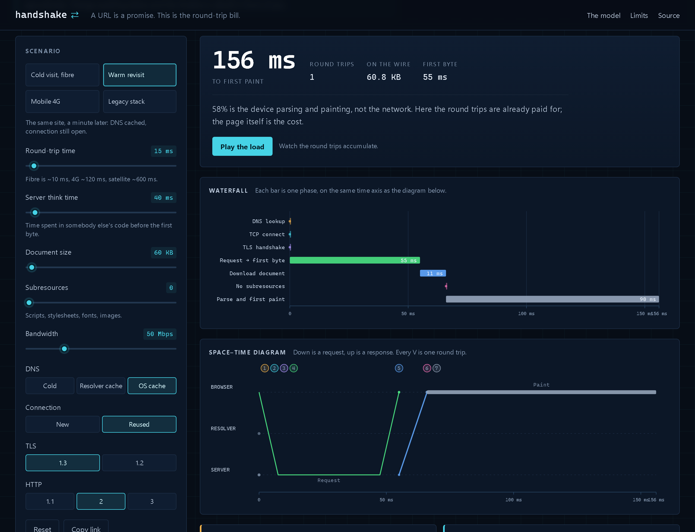
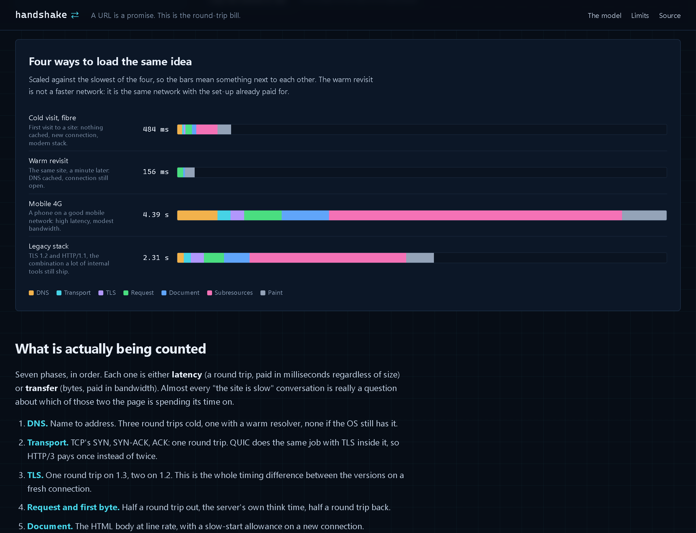
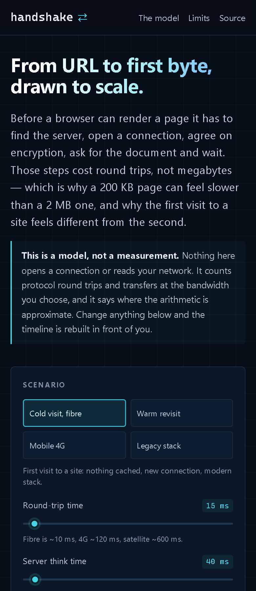

# handshake

**From a URL to the first pixel, drawn to scale: DNS, TCP or QUIC, TLS, the request, the download and the paint, with every round trip counted. One page, no build step, no server, no dependencies — and nothing here touches your network.**

<p>
  <a href="https://github.com/dominicnkutha1-netize/handshake/actions/workflows/ci.yml"></a>
  
  
  
  
  
  
</p>

**[Open handshake](https://dominicnkutha1-netize.github.io/handshake/)** — the default scenario is a cold visit over fibre: 484 ms, seven round trips, 794 KB on the wire.

<p align="center">
  <a href="docs/screenshots/hero.png"></a>
</p>

<sub><b>The whole argument in one screen.</b> Half a second for a page the network could move in 41 ms. The bars show where the time actually goes: 45 ms of DNS, 15 ms of TCP, 15 ms of TLS, 55 ms waiting for the server, 41 ms for the document, 193 ms for twenty subresources, 120 ms for the device to paint. Captured from the live page at the default cold-visit preset — no mock-up.</sub>

---

## Contents

- [Why this exists](#why-this-exists)
- [What it shows](#what-it-shows)
- [Screenshots](#screenshots)
- [How the model works](#how-the-model-works)
- [What this is not](#what-this-is-not)
- [Tech stack](#tech-stack)
- [Quick start](#quick-start)
- [Testing](#testing)
- [Deployment](#deployment)
- [Design decisions](#design-decisions)
- [Known limitations](#known-limitations)
- [Roadmap](#roadmap)
- [License](#license)

---

## Why this exists

"The site is slow" is usually two different complaints wearing the same coat. One is
**latency**: a fixed number of conversations with the server, each paid in round trips,
each costing the same whether the page is 20 KB or 2 MB. The other is **transfer**: bytes
moving through a pipe.

A waterfall chart tells you what happened. This page tells you *why it had to*: it draws
the protocol, not a recording. Change the round-trip time to 120 ms and watch the handshake
alone become most of the load. Switch TLS 1.2 to 1.3 and watch exactly one round trip
disappear. Turn on connection reuse and watch DNS, TCP and TLS collapse to nothing while the
server's think time and the download stay put.

That is the argument for keep-alive, HTTP/2, HTTP/3, CDNs and edge caches — not "faster
downloads", but fewer conversations. The arithmetic is simple enough to check in your head:
`ms = round trips × RTT + server time + bytes ÷ bandwidth`. The shape is what changes how
you think.

## What it shows

- **A summary you can argue with** — time to first paint, round trips, approximate bytes on
  the wire, first byte, and one sentence naming the dominant cost.
- **A waterfall** — one bar per phase, on the same time axis as the diagram below.
- **A space–time diagram** — three lanes (browser, resolver, server). Down is a request, up
  is a response; every V is one round trip, every diagonal is a transfer, and a phase that
  costs nothing is drawn as a dot instead of an imaginary packet.
- **Seven phase cards** — what the phase is, how many round trips and bytes it costs, why it
  exists, and the caveat that stops the number being over-read.
- **Controls that change the model, not a recording** — round-trip time, server think time,
  document size, number of subresources, bandwidth, DNS state, connection reuse, TLS version
  and HTTP version.
- **Four presets** — cold fibre, warm revisit, mobile 4G and a legacy TLS 1.2 / HTTP/1.1
  stack, compared on a shared scale.
- **An animation** — play the load and watch the playhead accumulate the round trips. It
  respects `prefers-reduced-motion: reduce` and shows the finished load instead.
- **A plain-text report** — copy the whole timeline for a ticket, a pull request or a
  post-mortem. Screenshots do not paste.
- **Shareable links** — every control is encoded in the query string, so
  `?rtt=120&dns=cold&tls=1.2&http=h1` is a reproducible argument.

## Screenshots

<p align="center">
  <a href="docs/screenshots/playing.png"></a>
</p>

<sub><b>Mid-flight.</b> The playhead is inside the subresource phase. Earlier phases stay lit, future phases dim, and the numbered chips on the diagram line up with the phase cards below. Captured after pressing Play on the live page.</sub>

<table>
  <tr>
    <td width="50%" valign="top">
      <a href="docs/screenshots/warm.png"></a><br>
      <sub><b>Same network, second visit</b> — 156 ms instead of 484 ms. DNS is cached, the connection is still open, and the page has no subresources to fetch. The only round trip left is the request itself; 58% of what remains is the device painting.</sub>
    </td>
    <td width="50%" valign="top">
      <a href="docs/screenshots/compare.png"></a><br>
      <sub><b>Four ways to load the same idea</b> — scaled against the slowest. The mobile phone is not slow because it has a slow CPU; it is slow because 120 ms of latency multiplies by seven round trips before the first byte arrives.</sub>
    </td>
  </tr>
</table>

<p align="center">
  <a href="docs/screenshots/mobile.png"></a>
</p>

<sub><b>One column on a phone.</b> The controls stack above the result, the charts scale to the viewport, and nothing scrolls sideways. The subject is mobile performance, so the page had better survive a phone.</sub>

## How the model works

Seven phases, in order. Each is either **latency** (round trips, paid in milliseconds
regardless of size) or **transfer** (bytes, paid in bandwidth).

| # | Phase | Shape | Cost |
|---|-------|-------|------|
| 1 | DNS lookup | browser ↔ resolver | 0 round trips in the OS cache, 1 at the resolver, 3 cold (root → TLD → authoritative) |
| 2 | Transport connect | browser ↔ server | 1 round trip for TCP; 1 for QUIC, with TLS 1.3 inside it |
| 3 | TLS handshake | browser ↔ server | 1 round trip for TLS 1.3, 2 for TLS 1.2; 0 when the connection is reused or the transport is QUIC |
| 4 | Request → first byte | browser ↔ server | half a round trip out, the server's think time, half a round trip back |
| 5 | Download document | server → browser | document size ÷ bandwidth, with a 1.4× slow-start allowance on a new connection |
| 6 | Subresources | server → browser | `ceil(assets ÷ concurrency)` request rounds, then all asset bytes ÷ bandwidth |
| 7 | Parse and first paint | browser only | a slider, because the honest answer varies by an order of magnitude |

The concurrency is **6** for HTTP/1.1 (browsers open about six connections per host) and
**100** for HTTP/2 and HTTP/3 (multiplexed streams over one connection). That single number
is why twenty assets arrive in four waves on HTTP/1.1 and one crossing on HTTP/2.

Everything is computed by [`assets/journey.js`](assets/journey.js), a pure module with no
DOM, no clock and no randomness. The drawing lives in
[`assets/render.js`](assets/render.js), which builds SVG strings so the same plan always
produces the same image. The browser code in [`assets/app.js`](assets/app.js) only reads
controls, calls the model and draws the result.

### The presets, in numbers

| Preset | Total | Round trips | On the wire | First byte |
|--------|-------|-------------|-------------|------------|
| Cold visit, fibre | **484 ms** | 7 | 794 KB | 130 ms |
| Warm revisit | **156 ms** | 1 | 60.8 KB | 55 ms |
| Mobile 4G | **4.39 s** | 7 | 1.4 MB | 940 ms |
| Legacy stack | **2.31 s** | 9 | 828 KB | 420 ms |

The warm revisit is not a faster network. It is the same network with the set-up already
paid for — which is the difference most people are actually feeling when they say a site
"got faster".

## What this is not

Stated on the page, in the README, and in the report the page copies:

- **Not a measurement.** It does not open a connection, read your network, or fetch the site
  you have in mind. Every number comes from the controls and the protocol facts above.
- **Not a benchmark.** A real navigation runs many connections in parallel, follows
  redirects, retries, and competes with other tabs. This models one clean navigation.
- **Not DNS-complete.** Real resolution has caches at the browser, OS, router and resolver,
  plus negative caching and TTL expiry. Three states is a teaching simplification.
- **Not TLS-complete.** Session resumption, 0-RTT, OCSP and certificate-chain size all move
  the numbers. One round trip for 1.3 and two for 1.2 is the floor, not the typical case.
- **Not a bandwidth test.** Throughput depends on congestion control, loss, stream count and
  the server's own limits. The bandwidth slider is a pipe, not a promise.
- **Not your user's device.** Parse and paint are an estimate with a slider. That is why the
  page calls the number rough wherever it appears.

If you need a measurement rather than a model, use the browser's own DevTools performance
panel, `curl -w`, or a real-user-monitoring tool. This page is for the conversation before
and after those numbers arrive.

## Tech stack

- **HTML, CSS and JavaScript ES modules** — no framework, no bundler, no package install.
- **SVG generated as strings** — testable in Node without a browser, crisp at any width.
- **`node:test`** for the model, the renderers and the site's own promises.
- **GitHub Pages** for hosting, **GitHub Actions** for CI.
- **Zero runtime dependencies, zero network calls, zero storage.** The page has no cookies
  and no analytics; the only state is the URL.

## Quick start

```bash
# any static server works; ES modules need http://, not file://
python -m http.server 8080
# then open http://127.0.0.1:8080/
```

Or with Node:

```bash
npx --yes serve . -l 8080
```

No install step. There is nothing to build.

## Testing

```bash
node --test
```

59 tests across three files:

- [`tests/journey.test.mjs`](tests/journey.test.mjs) — the arithmetic: round-trip counts for
  every DNS, connection, TLS and HTTP combination, bandwidth scaling, slow start,
  concurrency waves, clamping, determinism, report formatting.
- [`tests/render.test.mjs`](tests/render.test.mjs) — one bar per phase, a V per round trip,
  dots instead of imaginary packets, escaped markup, shared-scale comparison rows, and no
  `undefined` or `NaN` anywhere.
- [`tests/site.test.mjs`](tests/site.test.mjs) — local references exist, imports resolve,
  no third-party assets, no network APIs in `assets/`, metadata, labels, screenshots, and
  the page's claim that it is a model.

CI runs the suite on Node 20 and 22, then serves the site and fetches every asset. It also
fails the build if anything under `assets/` starts calling `fetch`, `XMLHttpRequest`,
`WebSocket` or `sendBeacon` — the privacy claim is a test, not a paragraph.

## Deployment

GitHub Pages serves the repository root from `main`. There is no build output: the files in
the repository are the site. Push to `main`, and the workflow in
[`.github/workflows/ci.yml`](.github/workflows/ci.yml) runs the tests; Pages publishes
independently.

## Design decisions

**A blueprint, not a dashboard.** The dark navy and cyan are a deliberate contrast with a
terminal-style tool: this is a diagram you can point at in a meeting. Amber is DNS, cyan is
transport, violet is TLS, green is the request, blue is the document, pink is subresources
and grey is the device. The phase cards use the same colours, so the legend is the page.

**Honesty as a feature.** The model's limits are in the intro, in a dedicated section, in
every phase's footnote and in the copied report. A tool that pretends to measure is worse
than no tool, because people quote it.

**No network, by construction.** The page never asks for a URL. That makes it safe to open
on a corporate laptop, and it makes the claim testable: the CI job greps `assets/` for every
way JavaScript can send bytes.

**Strings, not a charting library.** `render.js` returns SVG markup. There is no canvas, no
ResizeObserver and no third-party code; the tests can assert the shape of the drawing, and
the image stays sharp when the page is zoomed.

**Reduced motion is not an afterthought.** With `prefers-reduced-motion: reduce`, Play shows
the complete load immediately instead of animating. No information is lost.

**Mobile is the point.** The example that matters most — a phone on 4G — is a preset, not a
footnote, and the layout is tested at 390 px.

## Known limitations

- The model treats one navigation to one origin. Redirects, third-party origins, service
  workers, HTTP/2 prioritisation, connection coalescing and 0-RTT are out of scope.
- DNS states are coarse. Real caches expire, and a cold lookup can be answered by a
  forwarder that already has it.
- TLS byte counts are rough. Certificate chains vary from a few hundred bytes to several
  kilobytes, and session tickets change the second visit.
- Parse and paint are a single slider. Real first paint depends on the device, the CSS, the
  JavaScript and what the page considers painted.
- The animation gives each phase a minimum amount of screen time, so the playhead is not a
  literal real-time replay. It is a tour, and the page says so while it runs.
- Bytes are labelled "approx" everywhere on purpose. They are there to show that handshakes
  cost more than a request, not to be quoted as a packet capture.

## Roadmap

- An `Early Hints` / 103 preset, to show a round trip saved before the document.
- A side-by-side diff of two arbitrary scenarios, not just the four presets.
- Export the current diagram as a standalone SVG.
- A short "what to change first" checklist derived from whichever phase dominates.

Ideas and corrections are welcome as issues. If a number is wrong, say which one and show
the arithmetic.

## License

MIT — see [LICENSE](LICENSE). Use it, fork it, teach with it.
